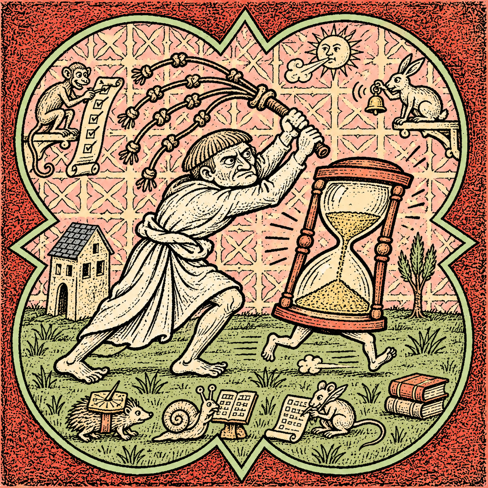

# Time Micromanager



A local Mac time tracker for research, teaching, and everything else. Requires macOS 14 or later. No account, network access, or third-party dependencies.

## Open the app

Existing installations may be named `~/Applications/FocusNest.app`; the new release is named `Time Micromanager.app`. The internal bundle identifier and data folder remain unchanged for continuity. For development, open `dist/Time Micromanager.app` after building, or use the Run action in Codex. The floating clock appears alongside the main window. Closing the main window leaves the timer available in the menu bar. Quit from the app menu to exit completely.

## Use it

- Use the **Project to time** dropdown in the timer panel, then press **Start**. It lists projects and nested subprojects by their full paths. Selecting a project in the sidebar also selects it in the timer panel. During tracking, choose another project and press **Switch & Start** to stop the old timer and begin the new one.
- **Pause** and **Resume** preserve the current session’s elapsed time. **New Session** starts the clock at zero.
- When finishing a chunk, click **Save Time**, including after pausing. The timer stops and a small **What did you work on?** window asks for a short phrase, such as **lecture prep** or **data analysis**. Choose **Save Time Chunk** to attach that description to this session’s paused/resumed portions and reset the clock for your next chunk. The words automatically feed **All projects → Overview → Notes**. Cancel keeps the time paused and resumable. The description is required to finish saving, and earlier sessions remain untouched.
- After pausing, choose **Discard** beside the elapsed timer to remove that session’s time instead. The small trash button on the paused floating clock opens the same confirmation in the dashboard. Cancel keeps the time. Confirming removes this session’s paused/resumed portions and resets its clock, while keeping the project and all other sessions. Resolve any pending away-time review before discarding a session.
- Right-click a project to edit it, set a weekly goal, or create a subproject. Subprojects roll up into their parents without doubling overall hours.
- Choose **Add Time** to enter work done elsewhere. Open **Time Entries** to edit or delete saved entries. If a saved time range overlaps existing work, the app lists the conflicts and asks whether to **Override**. Cancel leaves all records unchanged. Override replaces only the overlapping portions, preserving the rest of each original session, including notes. A session can split into two entries when the new work replaces its middle. A running timer continues after the replaced interval.
- Reports open to the current week, starting Monday. Browse weeks, months, all time, or a custom date range. Long-range charts show the last 31 days of that range; totals cover the entire selected range.
- **All projects → Weekly → Overview** includes a calendar-style timeline: Monday–Sunday columns, a compact 5:30 AM–10 PM time-of-day axis, and blocks placed at each session’s actual start and finish. Earlier or later sessions automatically expand the visible bounds outward in half-hour steps, including overnight work. Blocks use individual project colors and show task names when space permits; hover for exact times and duration. Daily hours remain above each day. Overnight work is split at midnight. Other report ranges and individual-project views retain their daily hours charts.
- The overview includes a total and daily average. A donut shows each category’s share, while a ranked horizontal chart lists category hours and the weekly total. Category charts group subprojects under their top-level category; selecting a category shows direct time and child rollups separately.
- The compact dashboard keeps the timer controls in one row, date navigation beside **Overview / Time Entries**, and weekly summaries above the timeline. Below it, **Projects**, **Charts**, **Notes**, and **Goals** tabs show one supporting panel at a time. Projects opens by default; Notes is available on All projects. The timeline retains its automatically expanding clock axis and daily totals.
- **All projects → Overview → Projects → Time by project** lists hours recorded directly on every project with time in the selected range, including subprojects such as **Other › Class/Homework**. These rows add up to the overall total; the **Charts** tab shows parent-category rollups.
- Project editing offers 20 named Tableau color swatches. Sidebar markers, stacked bars, donut slices, ranked bars, and goals use the same project colors. New projects prefer unused colors before reusing the least-used ones.
- On **All projects → Overview → Notes**, **In your own words** combines time-entry notes from the selected date range into a word cloud. Words mentioned in more notes appear larger. Colors follow the top-level category mentioning each word most, including its subprojects; hover for the category and note count. Common English words and numbers are omitted. Copied notes from split portions of one session count once. Up to 40 themes appear, with an empty-state prompt when no useful notes exist. Notes remain entirely on this Mac.
- The compact floating clock has a red case, cream face, and orange flip-style elapsed-time display. It shows minutes and seconds, adding an hours panel for sessions longer than an hour. Pauses are excluded. Drag the red top or bottom edge to move it. The face includes pause/resume, pin, dashboard, and hide controls; the same actions are available by right-clicking the clock.
- Show a hidden clock from the menu bar or with **Command–Shift–K**. Pause/resume with **Command–Shift–Space**.

## Forgotten timers

After 10 minutes without keyboard or mouse input, tracking pauses back at the last input. Adjust that threshold in Settings. Reading, writing on paper, or thinking can trigger this: the return dialog lets you retain the time, discard it, or select an earlier stop time.

Activity is measured across the whole Mac. Minimizing FocusNest, closing its dashboard, or working in another app keeps tracking. A delayed background timer update does not count as being away. FocusNest has one dashboard window; opening it repeatedly brings back the same window.

Locking the Mac or putting the display or computer to sleep pauses immediately. A pending review blocks new timers until resolved. Quitting or recovering from an unexpected exit also asks for review so overnight time is not silently counted. Unexpected-exit recovery trusts only the last saved heartbeat (up to 15 seconds before the exit).

Opening or returning to FocusNest brings up pending away-time review. If the automatic dialog is missed, use **Review Away Time** in the banner at the top of the dashboard, or the review control on the floating clock. The banner stays until you resolve the interval.

## Data and backups

Your records are saved atomically to:

`~/Library/Application Support/FocusNest/notebook.json`

Settings includes **Show Data in Finder**, **Export CSV…**, and **Restore CSV…**. CSV exports include categories, deadlines, time entries, notes, settings, and any pending away review. Restore validates the entire file, shows record counts for confirmation, and replaces the notebook without appending duplicate entries. Pause your timer and resolve any away review first. A pre-import JSON backup is written before replacement; a failed validation leaves current data untouched.

Before the first update save, the original JSON is preserved as `notebook-before-deadlines.json`. The `Backups` folder beside the notebook keeps the prior saved state once per day and a uniquely named snapshot before every CSV restore. These local copies protect against edits, but not losing the Mac: keep occasional CSV exports on another drive or backed-up folder. Backups are not automatically deleted.

To restore a JSON copy manually, quit FocusNest and replace `notebook.json` with the backup. The app refuses to overwrite a saved notebook it cannot read. App updates replace the app bundle, not this data folder.

CSV is a versioned FocusNest backup format, not an arbitrary spreadsheet import. The first row names the columns; record types are `notebook_v1`, `project`, `deadline`, and `entry`. Date columns use decimal seconds since 2001-01-01 UTC to retain exact native timestamp precision. Optional dates and references are empty fields. Keep IDs and column names intact. JSON remains the primary storage format; CSV is portable backup/restore.

## Deadlines

Choose **Deadlines** beside All projects, then **New Deadline**. Assign a title, due date/time and time category. The countdown uses local calendar days. Start or resume from its card, or choose the deadline in the regular timer. Edit an existing time entry to assign it to a task. One entry contributes to both task statistics and its existing category total without duplicating recorded hours.

Cards show total hours, distinct sessions, first work date, daily/accumulated hours and the busiest day/hour. Work spanning midnight or an hour boundary is split correctly. **Mark Complete** stops that task's timer and preserves its history. **Show completed tasks** displays summaries and a **Reopen** action. A task with recorded time keeps its original category.

## Development

```sh
swift run --disable-sandbox --cache-path .build/cache FocusCoreChecks
bash script/check_time_chunks.sh
bash script/check_deadlines.sh
./script/build_and_run.sh
```

The project uses SwiftPM, SwiftUI, AppKit for the floating panel, Charts, and CoreGraphics for input inactivity. The verification runner uses Foundation only, so full Xcode and separate testing frameworks are unnecessary.

`script/build_and_run.sh --build-only` builds an optimized release executable, stages and locally signs `dist/Time Micromanager.app`, and refreshes `dist/Time-Micromanager.zip` for sharing. Every release build (including Run) refreshes that ZIP and assigns a UTC timestamp build number visible in About FocusNest. Debug builds do not replace the sharing ZIP. Other supported modes: `--verify`, `--debug`, `--logs`, and `--telemetry`. The signature is for running locally; this is not a notarized distribution build.

## Resource usage

The seconds display updates independently of the dashboard. While tracking, reports refresh once per minute and immediately after edits; paused reports refresh when data changes or the calendar day changes. The floating clock and timer controls retain seconds precision. Time Entries creates rows as they come into view.

Notebook encoding and atomic writes run on one background queue. Rapid changes replace the pending snapshot with the latest state, keeping the queue bounded. Active timers still checkpoint every 15 seconds. Normal Quit waits for pending saves and stays open if writing fails. `--debug` builds a development executable; other build/run modes use release optimization.

## Share the latest version

Run `./script/build_and_run.sh --build-only`, then send `dist/Time-Micromanager.zip` after the command succeeds. Do this again after every source change; previously sent or copied ZIP files do not update automatically.

The recipient should quit FocusNest, unzip the new download, replace their existing FocusNest.app, and open that replacement. Their saved time records are separate from the app bundle. Compare the build number in About FocusNest to confirm both Macs are using the same build. Building locally does not replace a separate copy in ~/Applications.


## Performance checks

`swift run -c release --disable-sandbox --cache-path .build/cache DeadlineChecks --benchmark` checks export/import/statistics with 1,000, 20,000 and 100,000 synthetic entries. `bash script/build_performance_preview.sh` builds `.build/FocusNestTest.app`, an isolated UI preview with 20,000 entries and 100 deadline tasks. It uses a temporary notebook and reports peak resident memory to `$TMPDIR/FocusNest-performance.txt`; it never opens your real notebook.

## Preparing a public release

Source, tests and build scripts can be published independently of personal data. Local project history, build products, notebooks and backup files are excluded by `.gitignore`. Licensed under MIT; copyright (c) 2026 PitaChib. Public repository: `PitaChib/time-micromanager`. The current release is built for the host Mac architecture and locally signed, not notarized. A wider public binary release should include the intended architectures and Developer ID signing/notarization.

## License

[MIT](LICENSE), copyright (c) 2026 PitaChib.

## Credits and image provenance

Created and directed by **PitaChib**, with **ChatGPT / OpenAI Codex** assisting with implementation, debugging, tests, documentation and artwork prompts.

The medieval scholar-and-hourglass artwork was **AI-generated in ChatGPT using OpenAI image generation**, under PitaChib’s direction. 

The visual reference and whip-wielding taskmaster concept were inspired by **Anna Belfrage’s** October 14, 2020 post, [“When my imaginary taskmasker wields the whip – a post about inspiration and discipline”](https://www.annabelfrage.com/2020/10/14/when-my-imaginary-taskmasker-wields-the-whip-a-post-about-inspiration-and-discipline/). The linked article and its original images are not included in this repository or relicensed by this project. No endorsement by the author is implied. See [CREDITS.md](CREDITS.md).
